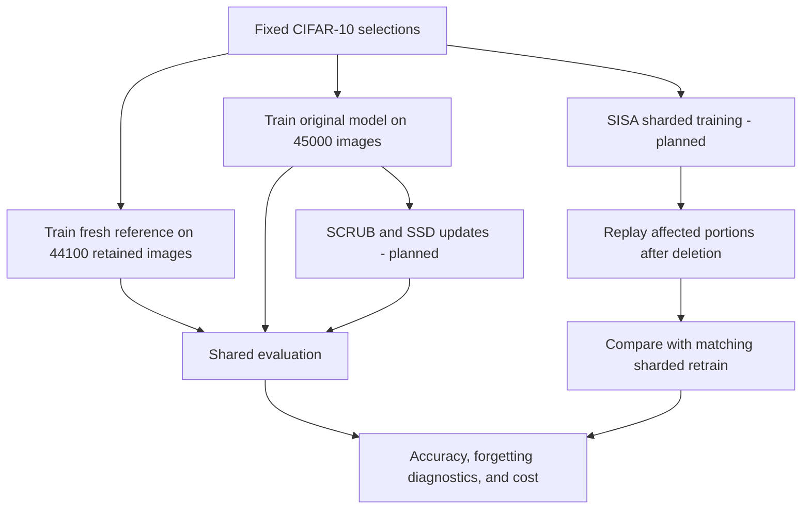

# 00 Start Here

A beginner-friendly research notebook for the KSU machine-unlearning project. Start with the concepts, then follow the experiment in order. No community plugins are required.

> [!summary] Current position
> The original model and the full-retraining reference have both completed training and evaluation. SISA, SCRUB, and SSD have **not yet been run in this restarted experiment**.

## Read in this order
1. [[Machine Unlearning Explained]]
2. [[Learning Vocabulary]]
3. [[Accuracy and Forgetting]]
4. [[Research Question and Setup]]
5. [[Dataset and Deletion Request]]
6. [[Chronological Roadmap]]
7. [[Verified Results]]

## Methods
[[Full Retraining]] · [[SISA]] · [[SCRUB]] · [[SSD]] · [[Method Comparison]]

## Research tools
[[Evaluation Plan]] · [[Reproducibility and Timing]] · [[Experiment Files]] · [[Research Log]] · [[Professor Meeting Notes]] · [[Sources and Evidence]]

## Experiment at a glance

SISA needs its own training setup; it is not an update to our existing single-model checkpoint.

## How to use this vault
Follow links between notes. Keep personal observations in [[Research Log]]. Treat results as single-run observations until repeated experiments support stronger conclusions. Evidence snapshots are stored in `06 Sources/Artifacts`; checkpoints and datasets remain in the project folders.

---
[[00 Start Here|Vault home]]
